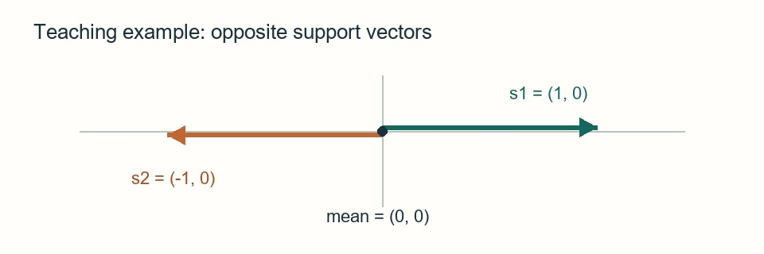

# 研究导向阅读：机制、证据与自检示例

> 这是呈现功能的教学示例，不是某篇真实论文的精读或实验结果。

## 📜 问题与核心思路

示例问题：如何让多个支持样本的信息参与一次查询评分？下面只演示均值聚合的数据流，不宣称它优于其他方法。

```paper-map
{"thesis":"先解释操作，再说明证据可以支持到哪里。","items":[{"number":"01","label":"研究问题","text":"多个支持表示如何形成供查询使用的参考？","source":"教学示例，非论文事实"},{"number":"02","label":"关键机制","text":"先聚合，再与查询表示计算相似度。","source":"本页教学定义"},{"number":"03","label":"证据边界","text":"流程可以计算，不等于有效性已经得到验证。","source":"教学示例的逻辑边界"}]}
```

## 👩🏻‍💻 机制与公式

先看下面的两步：支持表示进入均值聚合，输出的参考表示用于查询比较。这里没有学习参数，也没有实现完整训练过程。

```paper-path
{"title":"从支持表示到查询评分","stages":[{"title":"聚合支持","role":"表示构造","action":"对 K 个支持向量取均值。","why":"把多个输入表示合成一个参考。","output":"参考表示 p。","source":"本页教学定义"},{"title":"查询比较","role":"推理评分","action":"计算查询表示 q 与 p 的余弦相似度。","why":"把方向一致性转成一个分数。","output":"候选的相似度分数；不是概率。","source":"本页教学定义"}]}
```

均值参考为 $p=\frac{1}{K}\sum_{i=1}^{K}s_i$。其中 $s_i$ 是第 $i$ 个支持向量，$K$ 是支持样本数。这个定义本身不能保证参考表示对任务有用。

$$
\operatorname{score}(q,p)=\frac{q^\top p}{\|q\|_2\|p\|_2}
$$

该式要求两个向量非零；零向量的处理必须由实现另外规定。代码中的 `literal = "$x+y$"` 应保留为代码，不应被公式渲染器改写。

## 🧪 证据如何对应主张

```paper-experiments
{"title":"验证问题与剩余解释","rows":[{"question":"聚合是否改善排名？","setup":"匹配数据、编码器和评测协议后，对比使用与不使用该参考。","observation":"本示例没有运行实验，不能回答效果是否改善。","source":"教学方案，非实测"},{"question":"效果是否来自特定关系信息？","setup":"再加入打乱关系或统一参考等对照。","observation":"这些是可选验证思路，并非已执行的消融。","source":"教学方案，非实测"}]}
```

## 🙋‍♀️ 个人问题

如果支持表示互相抵消，均值是否还保留信息？这个问题可以先用小例子检查，再决定是否设计学习或评测对照。

下面的教学示意图画出两个反向的支持向量。关注它们在原点抵消的位置；它说明一个边界情况，不能说明真实数据出现这种情况的频率。



*本 skill 自绘教学示意，非原论文图片或实验结果。箭头只表示本页定义的两个向量。*

## 🧠 理解自检

1. 均值聚合不增加可训练参数，是否意味着它没有计算或信息成本？
2. 能写出评分公式，是否足以证明该方法有效？
3. 如果 $s_1=(1,0)$、$s_2=(-1,0)$，上述评分定义会遇到什么问题？

<details>
<summary>参考答案与判断依据</summary>

1. 仍需取得支持表示并执行聚合；成本取决于上游编码和计算规模。
2. 不足。可计算性与经验有效性是不同问题，需要相称的评测与对照。
3. 均值为零，余弦分母为零。必须规定零向量处理，不能直接使用原式。来源：本页公式的教学推导。

</details>
